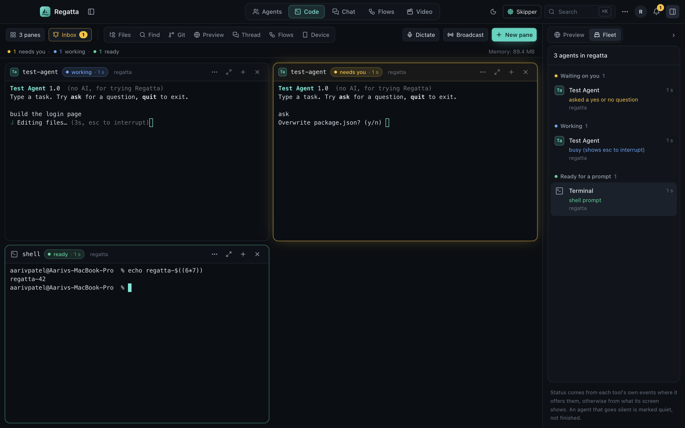
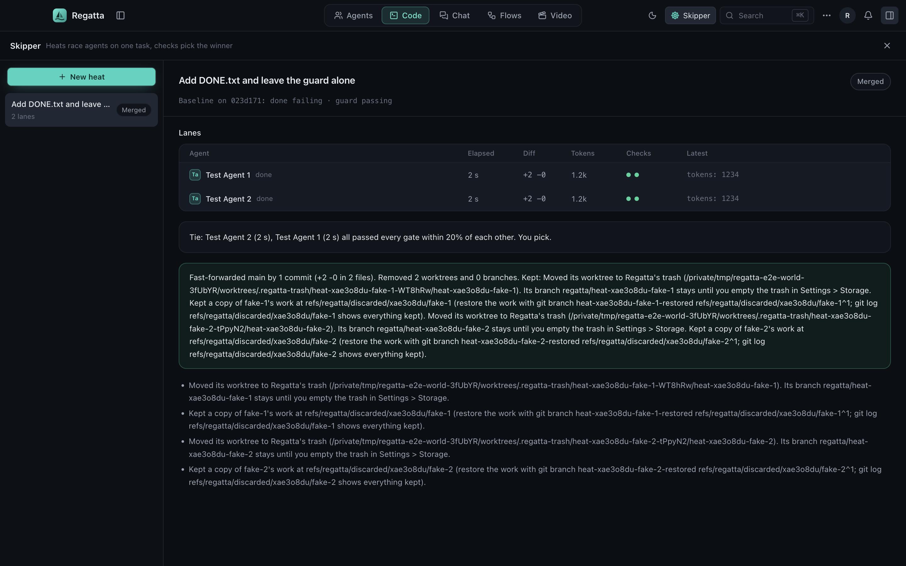
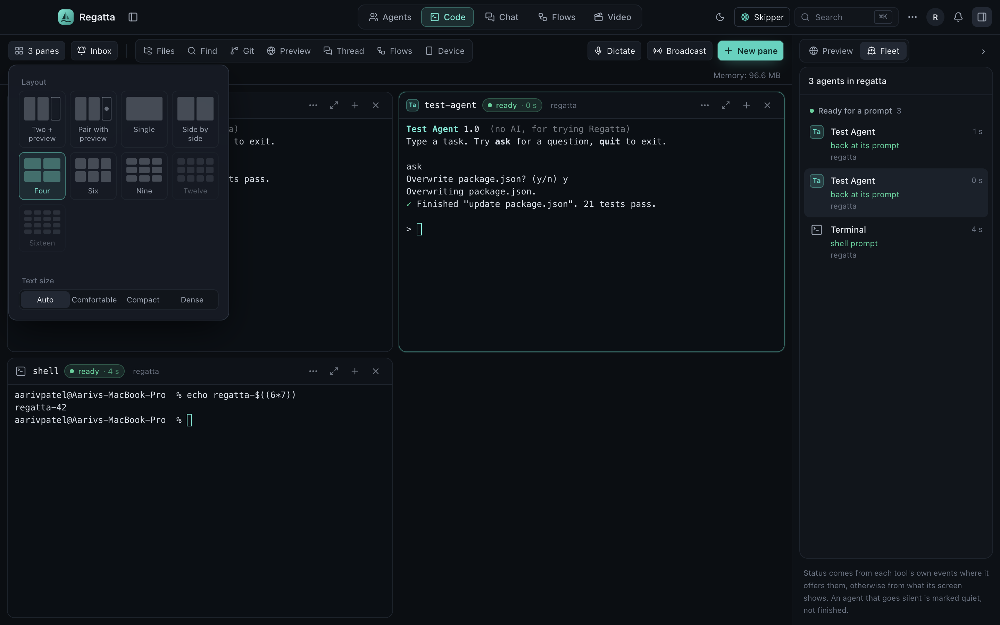

# Regatta

Regatta is a macOS desktop app I built with Electron, React, TypeScript, and `node-pty` to run multiple terminal sessions and git worktrees side by side without losing track of which pane needs input or accidentally clobbering uncommitted git work.



## Download and Try It

* **Download macOS Release (v0.1.0 DMG & ZIP):** [https://github.com/draarivpatel-ui/regatta/releases/tag/v0.1.0](https://github.com/draarivpatel-ui/regatta/releases/tag/v0.1.0)
* **Video Walkthrough:** [https://aariv.me/regatta/docs/demo-720p.mp4](https://aariv.me/regatta/docs/demo-720p.mp4)

### Opening the Downloaded App on macOS

Because I built and packaged this as a student without a paid $99/year Apple Developer ID account, the `.dmg` and `.zip` builds in the GitHub Release are ad-hoc signed (`codesign -s -`). The first time you open `Regatta.app` after downloading it, macOS Gatekeeper will block it because of the download quarantine flag.

To open it:
1. Drag `Regatta.app` to `/Applications`.
2. Run this in Terminal to clear the quarantine attribute:
   ```sh
   xattr -cr /Applications/Regatta.app
   ```
   (Or right-click `Regatta.app` in Finder and click **Open**.)

| Platform | Architecture | Status |
| :--- | :--- | :--- |
| macOS 13+ | Apple Silicon (`arm64`) | Supported and tested (`.dmg` and `.zip` on Releases page) |
| macOS 13+ | Intel (`x64`) | Build from source (`npm run dev`) |
| Windows / Linux | `x64` / `arm64` | Not supported yet (worktree safety checks use macOS `lsof` and APFS clonefile) |

## Why I Built This

Whenever I had three or four terminal tabs open on different git branches or worktrees, I kept running into two problems:
1. I couldn't tell at a glance which terminal was still compiling/running tests versus waiting at a prompt for a `y/n` confirmation.
2. Cleaning up temporary `git worktree` folders when switching branches is surprisingly easy to mess up. If you delete a worktree directory before checking whether it has unmerged commits or staged files, or while a background process is still writing to it, you can lose work.

So I built Regatta around two main ideas: a live multi-pane terminal grid that tracks process state per pane, and a worktree runner ("Heats") that isolates parallel runs in separate git worktrees and moves finished worktrees to a recoverable trash folder instead of deleting them.



## What Is Inside

* **Multi-pane terminal grid (`1` to `16` panes):** Real PTY terminals (`@lydell/node-pty` + `@xterm/xterm`) with a layout picker, a Fleet sidebar that sorts panes by urgency (`Needs you`, `Working`, `Failed`, `Ready`), and a cross-project Inbox.
* **Worktree Heats and Checkpoints:** Spin up 2 to 4 isolated git worktrees to test different approaches on the same task, run your project's test/lint commands against each lane, and only fast-forward merge when your branch hasn't moved and checks pass.
* **Non-destructive Worktree Trash (`.regatta-trash`):** Instead of running `rm -rf` on finished worktrees, Regatta saves unmerged commits under `refs/regatta/discarded/*`, checks `lsof` so it never moves or empties a directory with an open process, and keeps trashed worktrees in `Settings > Storage` until you explicitly empty them.
* **Built-in Git, Files, Find, and Preview panels:** Inspect diffs, search files, and preview a local dev server beside your terminal panes. The Git panel runs sandboxed git commands (`-c core.hooksPath=/dev/null`) so background status checks never trigger unexpected hooks or contact remotes.
* **Workspace Snapshot Exporter (`src/shared/session-export.ts`):** Exports your active panes, branches, and worktree check results as a Markdown table or TSV log.



## Building and Running from Source

You need macOS (Apple Silicon), Node.js 20+, and `git`.

```sh
git clone https://github.com/draarivpatel-ui/regatta.git
cd regatta
npm ci
npm run dev
```

Other scripts in `package.json`:

```sh
npm test        # run unit tests with Vitest
npm run check   # run TypeScript typecheck + unit tests
npm run e2e     # build and run the Playwright Electron end-to-end test suite
npm run dist    # package dist/Regatta-0.1.0-arm64.dmg and .zip via electron-builder
```

## Repository Layout

* `src/main/` - Electron main process: PTY manager, git worktree engine (`heats/`), checkpoint journal, storage & trash safety checks, local MCP server, and IPC handlers.
* `src/preload/` - Context-isolated preload bridge exposing typed IPC methods to the renderer.
* `src/renderer/` - React 19 + Tailwind CSS + Zustand UI (pane grid, Fleet sidebar, Heats view, Git diff viewer, Settings).
* `src/shared/` - Shared TypeScript types, theme contrast calculations, and session Markdown/TSV export helpers.
* `scripts/e2e/` - Playwright end-to-end tests that launch the built Electron app in an isolated temp home folder.
* `docs/` - Design notes on the repository safety rules (`docs/design/safety.md`) and packaging (`docs/PACKAGING.md`).

## License

MIT License. See [LICENSE](LICENSE).
